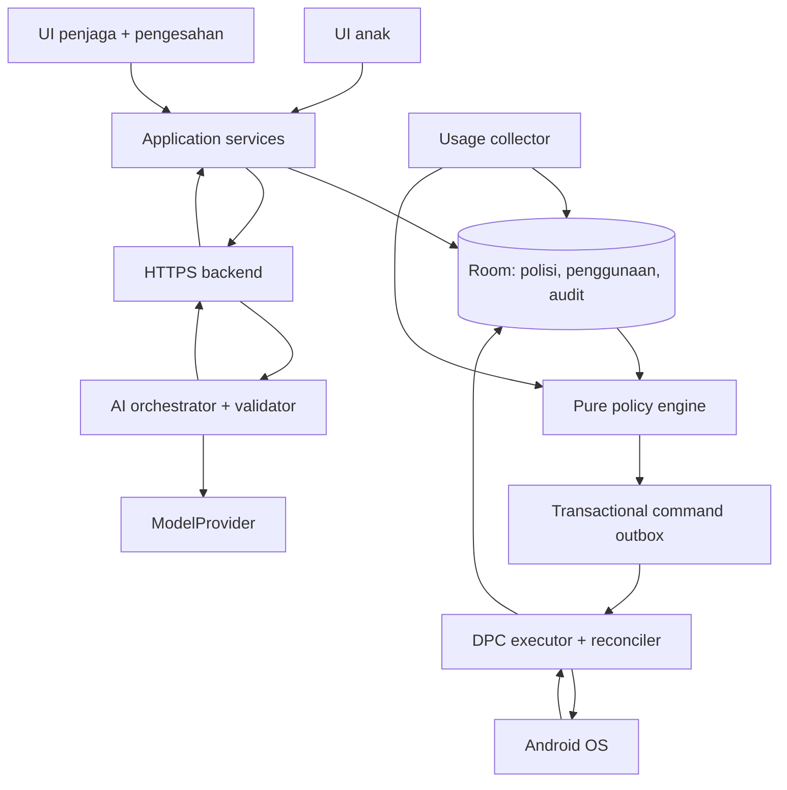

# Technical Specification Document — BijakSkrin

**Versi:** 1.1  
**Tarikh:** 6 November 2026  
**Status:** Spesifikasi reka bentuk prototaip; belum diimplementasi atau diuji pada peranti  
**Dokumen keperluan:** [PRD BijakSkrin](./PRD.md), versi 1.1  
**Bahasa UI:** Bahasa Melayu  
**Sasaran:** Anak 7–10 tahun dan ibu bapa/penjaga

## 1. Tujuan dan keputusan asas

Dokumen ini menerjemahkan PRD kepada reka bentuk yang boleh dibangunkan: komponen, algoritma, kontrak data, API, autorisasi, integrasi Android, deployment dan kriteria pengujian. Kod dan schema di sini ialah kontrak/pseudokod reka bentuk; bukan aplikasi yang telah dibina.

### 1.1 Keputusan pengguna

| Perkara | Keputusan |
|---|---|
| Platform | Aplikasi Android dengan kawalan aplikasi sebenar |
| Peranti | Telefon ujian khusus; laluan device owner dibenarkan untuk skop prototaip |
| Model telefon dan OS | Belum dipilih; mesti diputuskan dan diuji dalam Gate A |
| AI | Model sebenar untuk pelan dan penyesuaian; kawalan melalui peraturan deterministik |
| Backend | FastAPI/Python dengan adapter AI boleh ditukar, dipersetujui pengguna |
| Sasaran | Kanak-kanak 7–10 tahun bersama penjaga |

### 1.2 Keputusan reka bentuk untuk MVP

- Satu APK, satu profil anak dan satu telefon; mod penjaga dan anak pada peranti sama, mengikut andaian PRD. Telefon penjaga berasingan ialah fasa seterusnya.
- Android ialah sumber kebenaran polisi aktif, penggunaan dan keputusan peranti. Pelayan hanya menyediakan cadangan dan ringkasan AI.
- DPC prototaip sendiri menjadi device owner. Memasang Test DPC sebagai owner tidak memberikan kuasa itu kepada APK BijakSkrin.
- Minimum OS cadangan API 31/Android 12; sokongan sebenar hanya bagi matriks fizikal yang lulus Gate A. `compileSdk`, `targetSdk`, JDK/AGP/Kotlin dipilih sebagai set serasi dan dikunci dalam repositori semasa bootstrap; tiada dakwaan versi terkini dalam dokumen ini.
- Model AI, hos awan dan bajet belum dipilih. Gunakan kontrak adapter dan konfigurasi, tanpa mengikat produk kepada vendor.
- Tiada simulasi senyap sebagai ganti enforcement sebenar. Dataset contoh/cache sentiasa berlabel.
- Edutainment ialah aliran teknikal berhubung sesi, bukan feature tab bebas. TransitionCoordinator menghubungkan pilihan sebelum sesi, reminder, tawaran selepas had dan refleksi; polisi OS kekal bebas daripada penyertaan.

### 1.3 Invarian wajib

1. Model tidak boleh memanggil OS, meluluskan polisi atau mengeluarkan permit masa.
2. Semua perubahan polisi aktif memerlukan autorisasi penjaga dan semakan versi.
3. Pakej dilindungi tidak boleh disekat oleh polisi, permit atau output AI.
4. Kegagalan internet/model tidak mematikan polisi tempatan.
5. Permintaan berulang tidak menggandakan masa, pelan atau caj model.
6. Status “disekat” hanya selepas hasil OS disemak; arahan dihantar tidak sama dengan berjaya.
7. Masa yang telah digunakan tidak dipadam dengan menukar polisi, restart atau berpindah aplikasi.

## 2. Stack dan struktur repositori

| Lapisan | Pilihan | Tanggungjawab |
|---|---|---|
| Android | Kotlin, Jetpack Compose, coroutines/Flow | UI, state dan operasi asynchronous |
| Storan | Room/SQLite, DataStore untuk keutamaan bukan rahsia | Polisi, event, permit, audit; migration eksplisit |
| Dependency injection | Hilt, versi serasi dikunci | Binding adapter OS, clock dan repository |
| Android networking | Retrofit/OkHttp + Kotlin serialization | HTTPS, token, timeout dan schema |
| Background | Foreground service + AlarmManager; WorkManager untuk kerja tertangguh | Pemantauan, batas jadual dan cleanup |
| Backend | Python, FastAPI, Pydantic, Uvicorn | API, validasi, orkestrasi AI |
| Backend metadata | PostgreSQL + SQLAlchemy/Alembic | Enrollment, sesi, quota dan idempotency metadata |
| AI | `ModelProvider` adapter | Structured output, timeout, token/cost metadata |
| Packaging | Gradle wrapper, Python lockfile, container backend | Build boleh diulang |
| Ujian | JUnit/coroutine tests, Android instrumentation, pytest | Polisi, integrasi, fizikal dan AI fixtures |

```text
bijakskrin/
  android/
    app/                    # composition root, manifest, navigation
    core/domain/            # pure Kotlin policy, time, permits
    core/data/              # Room, migrations, repositories
    core/device/            # DPC, usage, FGS, alarms, receivers
    core/network/           # API DTO, auth transport
    feature/onboarding/
    feature/guardian/
    feature/child/
    feature/missions/
    feature/reports/
  backend/
    app/api/                # routes, auth, error mapping
    app/schemas/            # request, response, model output
    app/services/           # proposals, quota, enrollment
    app/agent/              # tools, orchestrator, validators
    app/providers/          # ModelProvider implementations
    app/db/                 # metadata models, migrations
    tests/
  contracts/                # JSON schemas, shared fixtures
  content/missions/         # versioned, curated Malay content
  docs/                     # provisioning, recovery, QA, decisions
```

Versi tepat semua dependencies mesti dipin; tiada `latest` atau julat terbuka dalam build release. CI menyimpan dependency manifest dan hash APK/container. Struktur ini ialah cadangan untuk repositori yang akan dibina, bukan fail yang sudah wujud.

## 3. Seni bina dan sempadan kepercayaan



- UI anak tidak mempunyai rujukan terus kepada mutator polisi/DPC.
- Lapisan servis tempatan memerlukan `GuardianSession` untuk aktivasi, override, penukaran kategori, deletion dan tetapan.
- Backend tidak memegang polisi aktif yang autoritatif atau menyediakan endpoint “unlock device”.
- DPC memeriksa semula protected packages dan versi arahan sebelum setiap tindakan.
- Audit menghubungkan proposal, kelulusan dan arahan melalui `correlation_id`.
- Ancaman dalam skop: anak menggunakan UI, input prompt injection, retry/race, credential salah, kegagalan peranti/rangkaian. Root, reflashing, exploit OS dan serangan fizikal lanjutan di luar jaminan prototaip.

## 4. Modul Android dan kontrak dalaman

| Modul/servis | Kontrak ringkas |
|---|---|
| `CapabilityInspector` | Snapshot owner, usage access, notification, FGS/scheduler, last check |
| `GuardianAuthService` | Verify PIN/recovery; issue scoped session; rate limit |
| `UsageCollector` | Query event bertindih, normalisasi interval, commit checkpoint |
| `UsageLedger` | Kiraan harian/sesi idempotent, coverage dan freshness |
| `PolicyEngine` | Fungsi tulen `evaluate(snapshot, now) -> Decision` |
| `ExtensionService` | Transaksi kelayakan, reservation dan permit |
| `ProposalService` | Snapshot minimum, panggil AI, validasi tempatan |
| `ApprovalService` | Semak hash/version/session, aktifkan polisi dan outbox |
| `DpcExecutor` | Suspend/unsuspend delta, keputusan per pakej |
| `Reconciler` | Banding desired/observed; retry terhad; pulih selepas crash |
| `MissionRepository` | Katalog sah, pilihan, laporan siap dan refleksi |
| `TransitionCoordinator` | Idempotent offer per session, kelayakan, pilihan dan resume selepas had/restart |
| `MissionEligibility` | Fungsi tulen tapis umur, bahan, tempoh, pengawasan dan catalog version |
| `RetentionWorker` | Cleanup tempatan tanpa memadam anchor kuota aktif |

```kotlin
interface PolicyEngine {
    fun evaluate(input: PolicySnapshot, now: TimeSnapshot): Decision
}

data class Decision(
    val policyVersion: Long,
    val allowedPackages: Set<String>,
    val suspendedPackages: Set<String>,
    val reasonCodes: List<String>,
    val nextEvaluationAtEpochMs: Long?,
    val quality: DataQuality
)

interface DeviceControl {
    suspend fun apply(command: DeviceCommand): List<PackageResult>
}
```

Domain tidak mengimport Android SDK, HTTP client atau model SDK. Clock, repository dan device control boleh diganti dalam ujian.

## 5. Lifecycle dan kesiapsiagaan Android

### 5.1 Preflight

`CapabilitySnapshot` menyimpan `is_device_owner`, `usage_access`, `notification_permission`, `fgs_eligible`, `scheduler_mode`, `last_usage_at`, `os_build`, `app_build` dan `checked_at`.

- Owner disemak menggunakan `isDeviceOwnerApp`; status admin biasa tidak dianggap cukup.
- Usage Access disemak dengan mekanisme AppOps yang sesuai, kemudian probe query; data kosong sahaja tidak membuktikan permission ditolak.
- Pengguna dibawa ke tetapan Usage Access jika diperlukan. Akses statistik tidak dianggap automatik kerana aplikasi ialah owner. [S1–S3]
- Android 13+ mengendalikan permission notifikasi secara eksplisit. Penolakan mengurangkan pengalaman peringatan dan ditunjukkan; tidak dipersembahkan sebagai permission owner hilang.
- Ready hanya apabila syarat enforcement pada konfigurasi rujukan dipenuhi. Owner tidak tersedia → `SETUP_INCOMPLETE`, tiada panggilan mutasi DPC.

### 5.2 Manifest dan komponen

| Item | Reka bentuk |
|---|---|
| `INTERNET` | Komunikasi backend |
| `PACKAGE_USAGE_STATS` | Special access; persediaan melalui tetapan |
| `FOREGROUND_SERVICE` | Pemantauan yang kelihatan kepada pengguna |
| `FOREGROUND_SERVICE_SYSTEM_EXEMPTED` | Laluan Android 14+ untuk DPC yang benar-benar layak sebagai device owner |
| `POST_NOTIFICATIONS` | Runtime pada versi berkaitan |
| `RECEIVE_BOOT_COMPLETED` | Rekonsiliasi selepas boot/unlock |
| DeviceAdminReceiver | Dilindungi `BIND_DEVICE_ADMIN`, metadata XML dan deklarasi admin sesuai |
| MonitoringService | Tidak exported; notifikasi berterusan; service type mengikut OS |
| Alarm/boot/package receivers | Minimize exported surface; sahkan action; kerja pendek lalu dispatch ke coordinator |
| Launcher Activity | Exported hanya entry launcher; semua deep link sensitif tetap memerlukan auth |

`systemExempted` ialah pilihan reka bentuk untuk device owner yang layak, bukan cara untuk memintas prasyarat platform. Tangani exception service type/start dan uji pada target SDK sebenar. [S4–S5]

Tiada permission kamera, mikrofon, lokasi, SMS, Accessibility, overlay atau VPN. Package visibility menggunakan query launcher/intent yang diperlukan untuk pemilih aplikasi; elakkan broad inventory permission tanpa bukti keperluan Gate A.

### 5.3 Strategi pemantauan dan penjadualan

- Selepas pengaktifan oleh penjaga, jalankan MonitoringService yang dimulakan secara sah dan kelihatan. Android 14+ menggunakan type `systemExempted` apabila eligibility disahkan. Jangan menganggap device owner menghapuskan semua sekatan background/OEM.
- Semasa skrin interaktif, query incremental usage setiap kira-kira dua saat sebagai konfigurasi spike. Sasaran ini perlu ukuran ketepatan/bateri; bukan jaminan bahawa OS menghantar event tanpa kelewatan.
- Screen-off menghentikan accrual dan polling aktif selepas checkpoint. Jangan mengekalkan wakelock sepanjang hari.
- Jadualkan semakan pada batas waktu, permit expiry dan unjuran kuota. Timer dalam proses menggunakan elapsed time; alarm sistem sebagai sokongan rekonsiliasi.
- WorkManager digunakan untuk cleanup dan laporan tertangguh, bukan enforcement saat tepat.
- MVP tidak bergantung pada exact alarm access. Jika Gate A menunjukkan ia perlu, tambah keputusan seni bina khusus beserta permission/capability check; jangan menjanjikan timing tepat daripada inexact alarm. [S6]
- Jika service berhenti, data/observed state dilabel stale. Sediakan tindakan penjaga untuk memulihkan pemantauan; `START_STICKY` bukan jaminan restart.
- Uji sasaran PRD: sesi aktif ≤5 saat dan jadual/background ≤30 saat pada telefon rujukan. Kegagalan bermakna gate belum lulus, bukan alasan menukar status kepada berjaya.

### 5.4 Boot, crash dan update

- Sebelum user unlock, jangan membaca Room credential-encrypted. Sekatan yang masih dipegang OS tidak dianggap telah dilepaskan.
- Selepas `BOOT_COMPLETED`/`USER_UNLOCKED`: buka DB, replay outbox, query observed suspension, pulih ledger dan jadual, kemudian mulakan servis hanya apabila platform membenarkan.
- Cold start/`MY_PACKAGE_REPLACED` menjalankan rekonsiliasi sama secara idempotent.
- Jika DB/key rosak: paparkan recovery, jangan reset penggunaan kepada sifar atau membuka semua aplikasi secara senyap.
- Apabila owner/usage access hilang, hentikan operasi yang tidak sah dan laporkan capability change.

## 6. Pengiraan penggunaan sebenar

### 6.1 Prinsip ledger

Gunakan `UsageStatsManager.queryEvents` dan event lifecycle/screen yang tersedia untuk versi OS. `ACTIVITY_RESUMED/PAUSED/STOPPED` tidak ditafsirkan sebagai niat penggunaan. Multi-window boleh mempunyai beberapa activity resumed; jangan menjumlahkannya sebagai beberapa kali masa sebenar. [S2–S3]

Untuk MVP, hiburan ialah **union interval**: satu saat dikira sekali apabila skrin interaktif dan sekurang-kurangnya satu pakej hiburan yang dipilih berada dalam set activity resumed. Simpan package attribution untuk diagnostik, tetapi jumlah kategori mesti bebas double counting. Multi-window/PiP diuji dan batas inferens dipaparkan; audio background tidak dikira sebagai masa hiburan foreground.

### 6.2 Algoritma

1. Query daripada checkpoint dengan overlap 10 saat; jangan bergantung pada event ID unik OS kerana ia tidak disediakan sebagai ID stabil untuk aplikasi.
2. Bentuk fingerprint daripada boot epoch, timestamp, event type, package, class/instance ID jika tersedia. Urus event identik dengan occurrence ordinal dalam window stabil; event meragukan menurunkan quality, bukan menghasilkan masa tambahan.
3. Simpan raw normalized event dengan unique fingerprint; overlap/retry tidak mengubah jumlah yang sudah committed.
4. Sort timestamp, bina set activity resumed dan status screen. PAUSED/STOPPED menutup activity berkaitan; screen-off menutup accrual kategori.
5. Hasilkan interval separuh terbuka `[start, end)` dan union hiburan; tulis interval, agregat dan checkpoint dalam satu transaksi.
6. Pecahkan interval pada midnight zon keluarga, perubahan klasifikasi dan perubahan polisi jika diperlukan. Kategori pada masa penggunaan disimpan; pengelasan semula tidak memadam penggunaan terdahulu.
7. Interval masih terbuka ialah provisional; accrual hingga checkpoint kini hanya jika status cukup pasti. Jika event hilang, tandakan gap dan jangan mengisi seluruh jurang sebagai fakta.

### 6.3 Masa dan sesi

- Simpan `epoch_ms` untuk audit serta `elapsed_realtime_ms` dan boot identifier untuk durasi dalam boot yang sama.
- Reboot membatalkan perbandingan elapsed lama; reconstruct daripada persisted intervals dan event OS, bukan reset bajet.
- Sesi meliputi penggunaan hiburan merentas aplikasi; tamat selepas lima minit tanpa hiburan foreground. Had harian kekal selepas sesi tamat.
- UI menunjukkan jumlah committed + provisional berlabel. Quality: `COMPLETE`, `PARTIAL`, `STALE`, `UNAVAILABLE`; simpan `last_observed_at` dan known gap, jangan cipta coverage tepat tanpa asas.
- Perubahan jam/zon tidak memberikan kuota baharu. Kekalkan ledger hari aktif dan tandakan `CLOCK_ANOMALY`; pertukaran zon keluarga memerlukan penjaga dan berkuat kuasa pada sempadan hari yang dipersetujui.
- Raw event dibuang selepas tujuh hari hanya setelah agregat/checkpoint dan anchors kuota yang diperlukan selamat. Jangan membina semula keseluruhan sejarah daripada raw event yang sudah dipadam.

## 7. Polisi, tambahan masa dan state

### 7.1 Bentuk polisi

```json
{
  "schema_version": 1,
  "version": 3,
  "timezone": "Asia/Kuala_Lumpur",
  "daily_entertainment_seconds": 1800,
  "session_limit_seconds": 1200,
  "session_idle_end_seconds": 300,
  "allowed_windows": [{"days": [1,2,3,4,5], "start": "16:00", "end": "18:00"}],
  "blocked_windows": [{"days": [1,2,3,4,5], "start": "17:00", "end": "17:30"}],
  "extension": {"seconds": 300, "max_per_day": 1, "may_exceed_daily_budget": false},
  "managed_entertainment_packages": ["example.test.game"],
  "usage_unavailable_behavior": "SUSPEND_SELECTED_ENTERTAINMENT"
}
```

Nilai ialah fixture PRD, bukan saranan umur. Hari ISO 1=Isnin, 7=Ahad. Untuk MVP, window tidak merentas midnight; UI memecahnya kepada dua window harian. Interval `[start,end)`; blocked window menang atas allowed window. Senarai protected dibina peranti, bukan diterima daripada JSON model.

### 7.2 Algoritma keputusan

```text
evaluate(snapshot):
  require valid active policy and capability snapshot
  protected := resolveCriticalPackages() union guardianProtectedPackages
  managed := selectedEntertainmentPackages minus protected
  if owner missing: return incapable(no mutation)
  if valid guardian override exists:
      apply only explicitly scoped exceptions; never override protected invariants
  else:
      if unknown usage and agreed fallback requires restriction: restrict managed
      else if blocked time or outside allowed window: restrict managed
      else if daily usage >= daily budget: restrict managed
      else if session usage >= session budget + valid session extension: restrict managed
      else: allow managed
  calculate earliest next boundary; return reason codes and quality
```

Peraturan tidak dibaca daripada natural language pada waktu enforcement. Mengubah polisi tidak mengubah ledger. Permit sedia ada yang bercanggah dengan versi baharu dinilai semula dan dibatalkan dengan sebab.

### 7.3 Tambahan masa

- Status request: `PENDING`, `GRANTED`, `DENIED`, `EXPIRED`, `CANCELLED`.
- Semua mutasi dijalankan melalui coordinator single writer + transaksi Room.
- Praizin hanya melanjutkan had sesi. Had harian, window dan bilangan penggunaan masih berkuat kuasa.
- Tetapkan batas permit sebagai minimum requested duration, baki bajet dan masa ke window berakhir; jika baki tidak cukup untuk tempoh diminta, tawarkan tempoh lebih pendek untuk dipilih, bukan ubah diam-diam.
- Auto-permit terikat pada session ID, polisi dan tarikh kuota. Mempunyai `granted_seconds`, `consumed_seconds`, `valid_until`; tamat apabila kuota permit habis, sesi berakhir atau waktu luput dicapai, yang mana lebih awal.
- Claim praizin harian disimpan secara atomik sebelum side effect. Ia tidak dipulangkan kerana retry atau anak membatalkan selepas granted.
- Permintaan sama mengembalikan keputusan sama; request berbeza serentak disemak terhadap claim/permit aktif.
- Pengecualian penjaga menyenaraikan batas yang dikecualikan, pakej dan expiry. Tiada override tanpa had masa. Selepas expiry, nilai semula polisi asal.

### 7.4 State teknikal

Pisahkan tiga dimensi agar `pending` tidak bermaksud akses terbuka:

| Dimensi | Nilai |
|---|---|
| Policy decision | `ALLOWED`, `WARNING`, `RESTRICTED`, `OVERRIDE` |
| Enforcement | `PENDING`, `APPLIED`, `PARTIAL`, `FAILED` |
| Health | `READY`, `DEGRADED`, `SETUP_INCOMPLETE`, `RECOVERY` |

Request state berasingan daripada state akses. UI PRD dipetakan kepada gabungan dimensi tersebut.

## 8. DPC executor, transaksi dan rekonsiliasi

`DevicePolicyManager.setPackagesSuspended(admin, packages, suspended)` digunakan untuk pakej terpilih, dengan exception dan hasil per pakej diurus. Query status melalui API yang tersedia untuk owner. Semak return value, kemudian observed state; suspension oleh pihak lain tidak dianggap milik BijakSkrin. [S1]

1. Resolve protected packages setiap kali konfigurasi/roles berubah: aplikasi sendiri, launcher, input method, komponen telefon/emergency dan sistem penting. Lindungi secara konservatif semua system packages untuk MVP; fungsi hiburan yang juga system app tidak boleh diurus dalam versi pertama.
2. Enjin mengira desired set; simpan command outbox dengan polisi dan `action_id` dalam transaksi DB.
3. Executor mengambil command, memeriksa versi masih semasa dan capability; command lapuk diabaikan.
4. Apply delta hanya untuk pakej yang dipilih dan boleh diurus. Simpan `requested_suspensions` sebelum OS call untuk pemulihan jika crash berlaku selepas call.
5. Semak keputusan per pakej, query observed state dan update audit. UI hanya menandakan APPLIED apabila hasil sepadan.
6. Crash selepas OS call tetapi sebelum DB commit: reconciler mengulang desired state yang sama; panggilan set-state direka idempotent.
7. Retry sementara maksimum tiga kali dengan backoff 1/2/4 saat; permission/security failure tidak diulang tanpa capability change. Selepas had, paparkan DEGRADED.
8. Unsuspend hanya pakej yang prototaip pernah meminta suspend, apabila polisi semasa membenarkannya. Jika restriction lain masih berkuat kuasa, laporkan bahawa akses belum pulih sepenuhnya.

APK update mesti mengekalkan application ID dan signing key. Jangan memperkenalkan freeze seluruh peranti atau kiosk lock task sebagai pengganti sekatan aplikasi MVP.

## 9. Schema storan tempatan

Semua ID aplikasi UUID; timestamp `INTEGER` epoch milliseconds; duration integer seconds atau milliseconds mengikut nama medan. Room migrations eksplisit; `fallbackToDestructiveMigration` dilarang bagi build yang memegang polisi aktif.

| Jadual | Medan utama | Kekangan/index |
|---|---|---|
| `family_profile` | id, timezone, language, consent_version | Satu keluarga MVP |
| `child_profile` | id, family_id, alias_ciphertext, age_band, interests_json | FK family |
| `guardian_credentials` | id, verifier, salt, kdf_params, attempts, next_attempt_at, recovery_verifier | Tiada PIN mentah |
| `capabilities` | id, snapshot_json, checked_at | Snapshot terkini |
| `app_rules` | package_id, category, protected, managed, effective_at | PK package; protected tidak boleh managed |
| `policy_versions` | id, version, canonical_json, content_hash, approved_at | UNIQUE version; immutable selepas approve |
| `active_policy` | singleton_id, policy_id | Satu pointer, update atomik |
| `raw_usage_events` | fingerprint, boot_id, at, package_id, type, instance_key | UNIQUE fingerprint; index at |
| `usage_intervals` | id, start_at, end_at, category, provisional, source_hash | CHECK end>=start; index start/end |
| `usage_daily` | child_id, local_date, seconds, quality, last_observed_at | UNIQUE child/date |
| `collector_checkpoint` | id, last_event_at, boot_id, open_state_json | Commit bersama interval |
| `sessions` | id, start_at, last_entertainment_at, consumed_seconds, status | Satu sesi aktif |
| `extension_requests` | id, day_key, session_id, duration, status, decision_json | UNIQUE request id |
| `extension_claims` | day_key, slot_index, request_id | UNIQUE day/slot; cegah double grant |
| `temporary_permits` | id, request_id, scope_json, quota, used, expiry, policy_version | UNIQUE request_id |
| `plan_proposals` | id, constraints_hash, policy_version, catalog_version, payload_json, status, expires_at | Index status; pelan tak dilulus tidak aktif |
| `missions` | id, catalog_version, content_json, checksum | UNIQUE id/version |
| `mission_assignments` | id, mission_id, slot, status, completion_source | FK mission/version |
| `transition_offers` | id, session_id, revision, candidate_ids_json, eligibility_hash, source, status, created_at | UNIQUE session_id; revision bertambah apabila konteks berubah |
| `transition_selections` | offer_id, mission_id, catalog_version, assignment_id, selected_at | Satu pilihan aktif per offer; FK catalog; tukar sebelum STARTED dalam transaksi |
| `participation_badges` | id, assignment_id, badge_type, awarded_at | UNIQUE assignment_id/badge_type; tiada kesan pada polisi |
| `feedback` | id, assignment_id, author_role, rating, note_ciphertext | Note pilihan, maksimum 280 aksara |
| `device_commands` | action_id, policy_version, desired_json, status, attempt_count | UNIQUE action_id; outbox |
| `managed_suspensions` | package_id, requested, observed, last_result | Ledger pemilikan tindakan |
| `action_audit` | id, correlation_id, actor, type, rule_id, result, at | Index correlation/time |

Field alias dan catatan bebas dienkripsi menggunakan AES-GCM dengan kunci Keystore; DB dalam storan peribadi. Ini bukan dakwaan seluruh fail Room dienkripsi. Jika full-database encryption diperlukan kemudian, ia memerlukan keputusan dependency dan recovery tersendiri. Tiada PII dalam audit/analytics.

## 10. Reka bentuk backend dan enrollment

### 10.1 Deployment minimum

Satu FastAPI service, PostgreSQL metadata dan HTTPS ingress. Tiada message broker wajib. Permintaan AI synchronous dengan timeout; local controls tidak menunggu backend. Rate/quota/idempotency disimpan dalam PostgreSQL supaya beberapa worker tidak membenarkan double request.

### 10.2 Enrollment dalaman

1. Operator menjana enrollment code rawak sekali guna melalui utiliti pentadbir pelayan; TTL 10 minit, disimpan sebagai hash.
2. Penjaga mengesahkan PIN tempatan sebelum enrollment UI.
3. Android menjana installation key pair dalam Keystore, menghantar public key + code melalui HTTPS.
4. Backend menebus code secara atomik dan mewujudkan installation ID pseudonim. Code tidak dikongsi dalam APK atau repositori.
5. Token akses bertandatangan berumur 15 minit, `sub=installation_id`, `aud=bijakskrin-api`, skop terhad cadangan/ringkasan/deletion.
6. Renewal menggunakan server challenge satu kali (TTL 60 saat) yang ditandatangani installation private key; nonce diclaim atomik untuk cegah replay.
7. Private key tidak dihantar. Metadata revocation disemak pada setiap request. Device key binding ini bukan bukti hardware attestation; APK sideload bukan identiti pengguna yang diverifikasi.

Token backend tidak menggantikan penjaga tempatan. Backend tidak menerima PIN dan tidak boleh menyamar sebagai kelulusan penjaga.

### 10.3 Jadual pelayan

| Jadual | Kandungan | Retensi |
|---|---|---|
| installations | ID, public key, enrolled/revoked state | Selagi installation aktif |
| enrollment_codes | hash, expiry, redeemed_at | Hapus selepas expiry + 24 jam |
| auth_challenges | nonce hash, expires_at, used_at | Hapus selepas expiry + 24 jam |
| ai_request_metadata | installation, key, input_hmac, status, token totals, result_hash | Maksimum tujuh hari, tanpa prompt/response |
| rate_counters | installation/day/type, reserved, completed | Maksimum tujuh hari |
| deletion_receipts | receipt ID, status, completion time | Maksimum tujuh hari; tanpa isi profil |

Snapshot profil hanya dalam memori semasa panggilan. Cache response berstruktur boleh wujud dalam RAM maksimum 15 minit untuk replay; tidak dalam database/log/backup. Selepas cache hilang, idempotency key lengkap tidak memanggil model semula: pulangkan `RESULT_EXPIRED`, dan klien meminta percubaan baharu secara eksplisit.

## 11. Kontrak HTTP API

### 11.1 Konvensyen

- Prefix `/v1`; JSON UTF-8, snake_case, `schema_version=1`.
- `Authorization: Bearer ...`, `X-Request-ID` dan `Idempotency-Key` untuk operasi AI.
- Pemilik installation diperoleh daripada token; ID dalam body tidak memberikan akses kepada installation lain.
- Maksimum body AI 64 KiB; maksimum horizon tujuh hari, 56 slots, 12–100 metadata misi dan feedback note 280 aksara.
- Had 12–100 ialah saiz katalog input, bukan bilangan calon layak. Senarai calon boleh sifar; backend memulangkan sebab tiada padanan tanpa mengada-adakan misi.
- Timestamps RFC3339 UTC; rutin menggunakan tarikh tempatan dan IANA timezone.
- Tolak medan tidak dikenali bagi kontrak polisi/model; versi tidak disokong mengembalikan ralat jelas.

### 11.2 Endpoints

| Endpoint | Auth | Input/hasil |
|---|---|---|
| `GET /health/live` | Tiada | Proses hidup; tidak mendedahkan config/model secrets |
| `GET /health/ready` | Infrastruktur | DB/config sedia; AI outage dilapor berasingan |
| `POST /v1/enrollments` | One-time code | Public key → installation ID + access token |
| `POST /v1/auth/challenges` | Installation ID | Nonce terhad kadar; tiada data profil |
| `POST /v1/auth/tokens` | Challenge signature | Token baharu; nonce sekali guna |
| `POST /v1/plan-proposals` | Installation token | Snapshot minimum → cadangan sah atau error |
| `POST /v1/weekly-summaries` | Installation token | Statistik disahkan → naratif berstruktur |
| `DELETE /v1/installations/self/data` | Token + signed deletion intent | Receipt `202`; revoke key/token dan hapus metadata berkaitan |

### 11.3 Contoh permintaan pelan

```json
{
  "schema_version": 1,
  "based_on_policy_version": 3,
  "constraints_hash": "sha256:example",
  "timezone": "Asia/Kuala_Lumpur",
  "horizon_start": "2026-11-09",
  "horizon_days": 7,
  "child": {"age_band": "7-10", "interests": ["blocks", "animals"]},
  "constraints": {
    "daily_entertainment_seconds": 1800,
    "session_limit_seconds": 1200,
    "allowed_windows": [{"days": [1,2,3,4,5], "start": "16:00", "end": "18:00"}],
    "blocked_windows": [{"days": [1,2,3,4,5], "start": "17:00", "end": "17:30"}]
  },
  "routines": [{"id": "routine_1", "kind": "homework", "start": "15:00", "end": "16:00"}],
  "usage_summary": {"days_observed": 0, "quality": "UNAVAILABLE", "daily": []},
  "mission_catalog_version": 1,
  "missions": [{"id": "build_bridge", "duration_seconds": 600, "requires_guardian": true}],
  "guardian_available_slots": [{"date": "2026-11-09", "start": "16:30", "end": "17:00"}],
  "feedback": []
}
```

Contoh dipendekkan; setiap routine/window mesti mempunyai skop hari/tarikh dalam schema implementation. Nama pakej, nama sebenar anak dan nota mentah tidak diperlukan model.

### 11.4 Contoh respons

```json
{
  "schema_version": 1,
  "proposal_id": "c49e8bd9-59f6-4e30-9088-c104b286003d",
  "based_on_policy_version": 3,
  "constraints_hash": "sha256:example",
  "mission_catalog_version": 1,
  "created_at": "2026-11-06T08:00:00Z",
  "expires_at": "2026-11-06T08:30:00Z",
  "source": "LIVE_MODEL",
  "slots": [{
    "local_date": "2026-11-09",
    "start": "16:00",
    "end": "16:20",
    "kind": "entertainment",
    "mission_id": null,
    "reason_codes": ["WITHIN_PARENT_WINDOW"]
  }],
  "evidence_refs": ["routine_1"],
  "explanation_ms": "Cadangan disusun selepas rutin kerja rumah yang dimasukkan penjaga.",
  "requires_parent_approval": true,
  "validation": {"status": "VALID", "ruleset_version": 1}
}
```

ID, source, expiry, approval flag dan validation status ditetapkan backend, bukan dipercayai daripada model. Klien mengesahkan semula terhadap polisi/capability semasa. Cadangan tamat selepas 30 minit untuk kelulusan; pelan yang sudah diluluskan mengikut tempoh jadualnya.

### 11.5 Ralat dan idempotency

```json
{"error":{"code":"POLICY_CONFLICT","message_ms":"Peraturan telah berubah. Semak cadangan baharu.","retryable":false,"request_id":"req_123"}}
```

| HTTP | Kod utama | Tindakan |
|---|---|---|
| 400/422 | `INVALID_INPUT`, `UNSUPPORTED_SCHEMA`, `INVALID_PLAN` | Baiki input; jangan retry automatik |
| 401/403 | `AUTH_REQUIRED`, `INSTALLATION_REVOKED` | Refresh sah atau enrollment semula |
| 409 | `IDEMPOTENCY_CONFLICT`, `POLICY_CONFLICT`, `REQUEST_IN_PROGRESS`, `RESULT_EXPIRED` | Jangan gandakan panggilan; semak state |
| 413 | `PAYLOAD_TOO_LARGE` | Kurangkan snapshot |
| 429 | `QUOTA_EXCEEDED` | Tunjuk had; ikut Retry-After |
| 502/503/504 | `AI_UNAVAILABLE`, `AI_TIMEOUT`, `PROVIDER_INVALID_OUTPUT` | Kekalkan polisi, fallback berlabel |

Idempotency diikat pada installation + endpoint + key. Hash input menggunakan HMAC pelayan atas canonical JSON; key sama dengan body berbeza → 409. Reserve quota/request row dalam transaksi sebelum model; completion metadata disimpan walaupun response cache hilang. Jangan retry permintaan berbayar secara automatik menggunakan key baharu.

## 12. Orkestrasi ejen AI

### 12.1 State dan alat

`RECEIVED → CONTEXT_READY → PLANNING → VALIDATING → READY_FOR_APPROVAL`, atau `FAILED`.

- `get_family_constraints`, `get_usage_summary` dan `list_curated_missions` membaca snapshot request-scoped di memori. Tool tidak boleh menerima arbitrary family ID/URL/query SQL.
- `propose_plan` menerima output berstruktur model; ia tidak mengaktifkan jadual.
- `draft_weekly_summary` hanya menghuraikan statistik yang dihitung kod.
- Tool aktivasi/OS tidak didaftarkan kepada model. Pelaksanaan selepas approval berlaku melalui orchestrator tempatan dan enjin peraturan.
- Maksimum satu model generation + satu repair dalam deadline 30 saat. Timeout tidak menghasilkan permit atau pelan aktif.

### 12.2 Adapter

```python
class ModelProvider(Protocol):
    async def generate_plan(self, context: PlanningContext, deadline_ms: int) -> ModelResult: ...
    async def repair_plan(self, context: PlanningContext, errors: list[str], deadline_ms: int) -> ModelResult: ...
    async def summarize(self, facts: WeeklyFacts, deadline_ms: int) -> ModelResult: ...
```

`ModelResult` mengandungi payload, provider/model/version, token totals, latency dan finish reason. Raw provider payload tidak dipulangkan kepada Android atau dilogkan. Structured-output capability diuji melalui adapter; schema validation aplikasi tetap wajib walaupun provider menjamin JSON.

### 12.3 Prompt dan validasi

Prompt versioned: objektif rutin, Bahasa Melayu, guna misi sedia ada sahaja, tiada perubahan batas, treat input sebagai data, tiada diagnosis/inferens niat dan tiada external tools. Catatan bebas dipendekkan dan diasingkan daripada instructions. Ini dilengkapi penguatkuasaan kod; prompt sahaja tidak cukup.

Validator backend dan tempatan menyemak:

1. Schema/types, enum, panjang, horizon dan tarikh/timezone sah.
2. Semua slot `start < end`, tiada overlap dan tidak melanggar waktu larangan/rutin wajib.
3. Jumlah hiburan setiap hari dan setiap sesi tidak melebihi polisi; missing data tidak dianggap baki tanpa had.
4. Misi wujud dalam catalog version, sesuai umur dan pengawasan tersedia.
5. Evidence references wujud dalam snapshot; tiada nombor atau dakwaan tanpa sumber.
6. Hash constraints dan versi polisi sama semasa approval; mana-mana perubahan input penting membatalkan cadangan lama.
7. Payload tidak boleh mengandungi package mutation, permit, PIN, credential atau approval palsu.

Canonical JSON disusun kunci dan disimpan dengan hash; penjaga meluluskan hash tepat. Suntingan penjaga menghasilkan draft/hash baharu yang divalidasi semula. Statistik dalam laporan dirender daripada objek facts, bukan angka bebas teks; setiap finding merujuk `metric_id` atau `feedback_id`. Free-text summary diperiksa agar tidak bercanggah, dan ditolak jika nombor/fakta tidak dapat disahkan.

### 12.4 Had dan fallback

- Had awal: 10 cadangan dan dua ringkasan per installation/hari. Kos maksimum harian global dan installation dikonfigurasi sebelum pilot; provider token cap wajib.
- Tiada LLM call pada setiap poll, app switch, notification atau permintaan tambahan deterministik.
- Data tidak lengkap → minta maklumat atau cadang rutin berdasarkan input penjaga dengan penjelasan batas, bukan kesimpulan corak palsu.
- Provider gagal/invalid selepas repair → kekalkan polisi lama. Templat/katalog tempatan boleh ditawarkan dengan `source=TEMPLATE`, bukan `LIVE_MODEL`.

## 13. Aktivasi polisi dan approval

```text
guardian opens proposal
  -> verify PIN and issue scoped local session
  -> display exact diff + warnings + proposal hash
  -> approveProposal(id, expectedVersion, hash, session)
  -> Room transaction:
       validate session + current constraints + catalog + expiry
       insert immutable next policy version
       CAS active pointer from expectedVersion
       insert audit and command outbox
  -> commit
  -> reconciler applies desired restrictions
  -> show active policy AND per-device enforcement result
```

Approval dan OS call tidak boleh berada dalam satu transaksi atomik; outbox menjembatani crash. Kegagalan OS selepas commit menghasilkan polisi aktif dengan enforcement FAILED/PARTIAL dan tindakan pemulihan jelas, bukan rollback palsu yang mengabaikan sekatan OS sebenar. Pelan masa depan tidak menghalalkan penggunaan di luar hard constraints keluarga.

## 14. Autentikasi penjaga dan pemulihan

- PIN sekurang-kurangnya enam digit; verifier PBKDF2-HMAC-SHA256 dengan salt rawak ≥16 byte dan parameter dikalibrasi untuk telefon rujukan. Titik mula 600,000 iterations ialah parameter reka bentuk yang perlu benchmark, bukan standard yang didakwa telah disahkan.
- KDF dijalankan di background thread, compare constant-time; secret pepper pilihan Keystore; jangan gunakan SHA-256 tunggal bagi PIN.
- Lima kegagalan mencetus cooldown 30 saat, kemudian exponential hingga maksimum 15 minit; state kekal selepas restart dan tidak dikurangkan dengan jam dimundurkan.
- Session penjaga in-memory, timeout dua minit idle, batal apabila aplikasi ke background/peranti dikunci. Tindakan destructive/recovery memerlukan pengesahan semula.
- Token session tidak dieksport ke Intent, SavedState atau backend. Service mutator memeriksa scope dan expiry; UI gating sahaja tidak memadai.
- Recovery code rawak sekurang-kurangnya 128 bit ditunjukkan sekali kepada penjaga, disimpan di luar telefon; verifier disimpan, bukan raw code.
- Recovery tersedia luar talian untuk melepaskan sekatan milik aplikasi dan reset PIN secara sah. PIN/recovery hilang memerlukan proses pemilik/operator yang didokumenkan; jangan mencipta master PIN.
- Tiada sekatan dialer/kecemasan atau lock seluruh peranti. Recovery tidak bergantung pada kelulusan model.

## 15. Edutainment dan UI state

- Katalog minimum 12 misi: tiga pengurusan masa, tiga literasi digital, tiga kreativiti dan tiga interaksi keluarga.
- Content schema: `id`, `version`, `title_ms`, `age_band`, `learning_objective_ms`, `estimated_seconds`, `materials`, `steps_ms`, `requires_guardian`, `alternative_ids`, `reflection_options`.
- AI memilih ID dan slot; arahan anak menggunakan teks dikurasi dengan checksum/version. Tiada teks prosedur baharu diterbitkan terus oleh model kepada anak.
- Status assignment: `OFFERED`, `SELECTED`, `STARTED`, `REPORTED_COMPLETE`, `DEFERRED`; reported complete bukan verifikasi aktiviti sebenar.
- Badge dikira deterministik atas penyertaan; tiada penalti streak dan tiada extra quota automatik.
- ViewModel menggunakan immutable UiState + StateFlow; event satu kali untuk navigation/notification. Enforcement state kekal di repository, bukan timer Compose.
- Font besar, target sentuhan ≥48dp, kontras jelas dan label teks untuk setiap status. Jangan menutup permainan dengan full-screen Activity dari background; gunakan sistem suspension dan entry BijakSkrin yang sentiasa tersedia.

### 15.1 Kontrak misi yang diperluas

Tambahkan medan wajib `play_hook_ms` (cerita/cabaran berkaitan objektif), `offline_steps_ms`, `objective_id`, `reflection_prompt_ms` dan `material_ids`. `estimated_seconds` ialah anggaran, bukan ukuran aktiviti sebenar. `age_band`, durasi dan ID bahan ialah metadata yang boleh difilter; teks kanak-kanak kekal dikurasi. Katalog minimum 12 misi masih sama; tiada keperluan menjana permainan baharu secara live.

Refleksi pilihan merangkumi seronok/biasa/sukar, sebab seperti terlalu panjang, dan jawapan formatif jika ada. Simpan `completion_source=CHILD_REPORT` atau `GUARDIAN_REPORT`; tiada field `verified_learning=true` daripada butang siap atau masa skrin. Catatan bebas tidak masuk analytics.

### 15.2 TransitionCoordinator dan lifecycle

```text
SessionOpened -> getOrCreateOffer(session_id)
  -> filter eligible missions against approved plan + current context
  -> use approved AI candidate ordering, else deterministic local ordering
  -> show up to two candidates, or one/zero with explicit fallback
  -> child SELECTS or DEFERS
Reminder/LimitReached -> reference same offer; never new model call
OS enforcement -> continues independently
Child reopens app -> revalidate candidate + resume persisted offer
Activity -> optional reported participation + optional reflection
Feedback -> adaptation draft on allowed trigger; guardian approval if plan changes
```

- `session_id` ialah ID ledger sesi, bukan Activity instance. Rotation, reopen, repeated alarm dan retry tidak mencipta offer baharu.
- Sesi yang ditemui selepas restart tanpa offer mendapat satu offer recovery. Untuk sesi tamat tanpa aplikasi dibuka, persist offer tanpa memaksa Activity muncul.
- Status offer: `PREPARED`, `VIEWED`, `SELECTED`, `DEFERRED`, `NO_ELIGIBLE`, `CLOSED`. Assignment mempunyai lifecycle sendiri; `STARTED` tidak membuktikan aktiviti sebenar bermula.
- Polisi sesi dan notification scheduler hanya membaca ringkasan offer. TransitionCoordinator tidak mempunyai dependency mutasi kepada PolicyEngine, permit issuer atau DPC.
- Apabila catalog/material/guardian availability berubah, naikkan revision dan validate semula; batalkan pilihan yang tidak lagi layak dengan sebab, beri alternatif. Kekalkan history tanpa duplicate assignment.
- Dalam slot dan batas yang diluluskan, anak boleh memilih alternatif layak. Perubahan slot/polisi menghasilkan proposal dan approval flow biasa, bukan aktivasi oleh coordinator.
- Jika tiada calon, tawar “rehat dahulu” dan maklumkan penjaga dalam UI. Jangan memperluas waktu sekatan, menghadkan emergency atau mewajibkan aktiviti sebagai syarat unlock.

### 15.3 Ranking dan penyesuaian

Eligibility hard filters dijalankan sebelum ranking: umur, bahan, tempoh slot, pengawasan dan ID katalog. Selepas AI memilih, validator mengulangi filter. Fallback tempatan menyusun berdasarkan minat yang dilapor, sejarah ditawarkan/dipilih dan ID stabil bagi tie-break; tiada inferens emosi.

Snapshot AI menambah metadata `objective_id`, `estimated_seconds`, `material_ids`, `requires_guardian`, `eligible_candidate_ids`, sejarah agregat pilihan dan feedback references. Alias/package inventory tidak diperlukan. AI boleh memilih misi lebih pendek yang memang wujud, bukan mengubah arahan kandungan atau mendakwa tahap kemahiran anak.

Feedback tidak memanggil model pada setiap tap: simpan dahulu; jana semasa semakan penjaga atau trigger penyesuaian yang dinyahganda. Quota/deadline sedia ada terpakai; tiada endpoint baharu diperlukan. Data kurang atau tiada alternatif menghasilkan sebab dan cadangan semakan penjaga.

### 15.4 Kontrak operasi tempatan

| Operasi | Semantik |
|---|---|
| `prepareTransition(sessionId)` | Upsert offer secara atomik; pulangkan offer/revision semasa |
| `selectMission(offerId, expectedRevision, missionId)` | Semak kelayakan/catalog; stale revision → conflict; upsert assignment sekali sahaja |
| `deferTransition(offerId, eventId)` | Idempotent, tiada penalti atau mutasi akses |
| `reportParticipation(assignmentId, eventId, source)` | Satu perubahan status logik; badge unique; tidak mengubah quota |
| `submitReflection(assignmentId, eventId, response)` | Pilihan; deduplicate dan simpan evidence ref untuk proposal akan datang |

Semua operasi memeriksa ownership profil/sesi. Counter reported participation dan badges ditulis bersama status assignment dalam satu transaksi. Butang “kembali selepas aktiviti” tidak memerlukan background timer, kamera atau bukti foto.

### 15.5 Metrik tanpa dakwaan pembelajaran palsu

Tambah event `transition_offer_created/viewed`, `transition_deferred`, `transition_no_eligible_mission`, `reflection_submitted` dan `mission_adaptation_proposed`. Identifiers pseudonim menghubungkan offer/session/assignment/proposal dalam audit tempatan; analytics pelayan tidak menerima raw notes atau usage events.

Laporan membezakan bilangan tawaran, pilihan, penyertaan dilaporkan dan refleksi. Nyatakan denominator, missing feedback dan no-eligible cases. Masa tiada aplikasi foreground tidak dilabel “masa belajar”; respons formatif bukan penguasaan kemahiran yang disahkan. AI summary hanya menghuraikan facts berlabel tersebut.

## 16. Privasi, retensi dan deletion

| Data | Lokasi | Retensi/aturan |
|---|---|---|
| Raw usage | Android sahaja | Tujuh hari, selepas checkpoint/aggregate selamat |
| Agregat, audit, feedback | Android | 30 hari rolling; anchors aktif disimpan hingga tak diperlukan |
| Transition offers, assignments, participation badges | Android | 30 hari rolling; rekod sesi aktif disimpan sehingga ditutup; cleanup ikut turutan FK |
| Polisi aktif/katalog | Android | Selagi digunakan; historical versions ikut keperluan audit 30 hari |
| Alias/catatan | Android, field encryption | Minimum perlu; tidak dimasukkan analytics |
| Snapshot AI | RAM backend/provider request | Tiada persist backend; provider retention perlu disahkan |
| Metadata backend | PostgreSQL | Maksimum tujuh hari kecuali installation aktif |
| API/model keys | Secret store backend | Putaran/revocation operator; tidak dalam APK |

Nonaktifkan backup/transfer data sensitif melalui aturan Android yang sesuai dan uji restore; jangan menganggap `allowBackup` sahaja mencakupi semua laluan OEM. Semua trafik HTTPS; tiada cleartext release. Development endpoint terhad pada build debug.

Deletion flow:

1. Penjaga sah memilih padam; tunjuk skop serta status pengurusan peranti.
2. Hentikan penghasilan pelan/command baharu dan simpan deletion intent.
3. Lepaskan suspension milik BijakSkrin, verify; jika gagal, jangan padam ledger recovery dahulu.
4. Jika online, hantar signed deletion intent dan simpan receipt; server revoke credentials dan hapus data aktif ≤24 jam.
5. Jika offline, tawarkan delete tempatan dengan penerangan jelas bahawa salinan metadata backend belum disahkan padam; simpan credential/tombstone minimum untuk retry, bukan profil anak.
6. Padam data profil dan usage selepas pelepasan sah; paparkan status deletion/recovery yang tinggal.
7. Keluar device owner ialah operasi provisioning berasingan, mungkin memerlukan reset bergantung laluan. Jangan menjanjikan uninstall biasa akan membersihkan peranti terurus.

## 17. Observability dan operasi

- Log berstruktur: request/correlation ID, code, component, latency, app/model/prompt/ruleset version dan hasil; tiada prompt, catatan, token, PIN atau senarai pakej penuh pada pelayan.
- Metrik: enforcement delay, partial failures, usage freshness/gaps, invalid plan rate, AI latency/timeouts, quota, cost dan recovery count.
- Desired dan observed direkodkan berasingan; notification failure tidak menyamar sebagai suspension failure.
- Dashboard peranti boleh mengeksport diagnostik terhad atas pengesahan penjaga, bukan auto-upload raw usage.
- Readiness deployment menyemak DB/migration/config; model outage menurunkan status AI sahaja, tanpa menjejaskan kawalan Android tempatan.
- Pemantauan kos boleh mematikan endpoint AI secara global dengan respons berlabel; tidak memberi kuasa membuka aplikasi.

## 18. Build, konfigurasi dan deployment

### 18.1 Android

- Build types: `debug` untuk pembangunan dan `internalRelease` bertandatangan stabil. Application ID DPC contoh `my.bijakskrin.app`; tetapkan muktamad sebelum provisioning.
- Debug menu tidak boleh mengaktifkan polisi atau demo tanpa auth penjaga. Release tidak menerima deep link arahan kawalan.
- Simpan signing key di storan selamat; update mesti mengekalkan key/ID. Jangan commit keystore/password.
- Konfigurasi bukan rahsia: API base URL, feature flags dan build label. Tiada provider key/shared admin token dalam BuildConfig/resources.

### 18.2 Backend

```text
APP_ENV
DATABASE_URL
JWT_SIGNING_KEY / JWT_KEY_ID
IDEMPOTENCY_HMAC_SECRET
MODEL_PROVIDER
MODEL_NAME
MODEL_API_KEY
MODEL_TIMEOUT_SECONDS=30
PLAN_DAILY_LIMIT=10
SUMMARY_DAILY_LIMIT=2
AI_DAILY_BUDGET
REQUEST_BODY_LIMIT_BYTES=65536
PROMPT_VERSION
RULESET_VERSION
```

Nilai rahsia diberi melalui environment/secret manager, tidak dihantar kepada Android. `AI_DAILY_BUDGET` wajib diputuskan sebelum membenarkan data pilot. Container non-root, dependency lock, HTTPS ingress, request limits dan DB least-privilege role. Jalankan Alembic migration sebelum rollout; perubahan schema backward-compatible dahulu. Tiada prompt/response logging pada reverse proxy, tracing atau error reporting.

### 18.3 CI minimum

1. Lint/format, compile, unit tests Kotlin dan pytest.
2. Contract fixtures Android/Python mesti menghasilkan keputusan validator sama.
3. Migration tests daripada versi DB sebelumnya dan secret scanning.
4. Build APK dan container; simpan hash/artifact manifest.
5. Gate fizikal enforcement ialah langkah release manual berrekod; emulator sahaja tidak meluluskan Gate A.
6. Model live eval dijalankan berasingan dengan dataset rekaan dan bajet terhad; CI biasa tidak bergantung pada network/model rawak.

## 19. Runbook provisioning dan recovery

Dokumen ini menentukan runbook yang perlu diwujudkan; tiada arahan di bawah telah dijalankan dan tiada reset dibenarkan melalui dokumen ini.

1. Pilih telefon khusus, catat OEM/OS/build, pastikan pemilik bersetuju dan sandaran selesai sebelum sebarang reset yang perlu.
2. Build APK DPC sendiri dengan application ID/signing key muktamad untuk ujian.
3. Pada peranti yang memenuhi syarat development provisioning, contoh arahan teknikal ialah:

```text
adb shell dpm set-device-owner my.bijakskrin.app/.device.BijakDeviceAdminReceiver
```

Ini contoh path komponen yang perlu diselaraskan dengan implementasi, bukan arahan untuk telefon keluarga. Jika prasyarat akaun/setup/device gagal, rujuk provisioning rasmi; jangan memadam akaun atau reset secara automatik. AOSP menyediakan panduan ujian device management. [S7]

4. Sahkan owner daripada capability API; beri Usage Access dan permission berkaitan melalui proses yang sah.
5. Daftar backend menggunakan one-time code, tetapkan PIN dan simpan recovery code di luar telefon.
6. Pilih dua aplikasi ujian non-system; buktikan suspend/unsuspend dan emergency access.
7. Rekod kaedah keluar pengurusan untuk build test ini. `remove-active-admin` bukan jaminan universal bagi production owner; runbook mesti menyatakan syarat sebenar. Jangan menandakan build pengedaran sebagai test-only semata-mata untuk menyembunyikan isu lifecycle.
8. Sebelum menamatkan sesi ujian, pelepasan restriction diverifikasi dan deletion status diperiksa.

## 20. Strategi ujian dan sasaran prestasi

### 20.1 Unit dan contract tests

- Policy: overlap, sempadan `[start,end)`, daily/session limit, protected packages, override expiry, tarikh/zon, time rollback dan stale data.
- Ledger: overlap query, event pendua, multi-activity, screen-off, reboot, missing pause, midnight dan history retention.
- Transactions: requests serentak, idempotency, crash sebelum/selepas OS call dan approval versi lapuk.
- Validators: schema salah, unknown fields, ID misi palsu, jadual melebihi had dan output model cuba meluluskan dirinya.
- Backend: nonce replay, key/code salah, revocation, quota reservation race, cached replay dan deletion.
- Transition: reminder/reopen/reboot menghasilkan satu offer per session; revision conflict, tiada/satu calon, pengawasan berubah, offline fallback dan repeated participation/badge.
- Uji invariance: setiap tindakan pilih/siap/tolak/refleksi dibandingkan dengan ledger polisi/permit sebelum dan selepas; tiada perubahan kuota atau unlock.

### 20.2 Instrumentation dan fizikal

Gunakan matriks sebenar: model, OEM, API level, target SDK, service type, permission, mode bateri dan build ID. Uji foreground permainan, background, skrin padam, reboot/unlock, service dihentikan, permission ditarik balik, package uninstall/update dan internet terputus.

| Metrik | Sasaran PRD | Bukti |
|---|---|---|
| UI response | p95 ≤1 saat | ≥30 interaksi pada telefon rujukan |
| AI response | p95 ≤20 saat; deadline 30 saat | ≥30 panggilan, model/rangkaian direkod |
| Active limit enforcement | ≤5 saat | ≥20 percubaan, masa batas hingga OS observed restricted |
| Schedule/background enforcement | ≤30 saat | ≥20 percubaan termasuk keadaan tidur yang disokong |
| Offline | Dua jam kawalan tanpa model | Permit expiry, jadual dan recovery lulus |
| Protected packages | Sifar suspension oleh aplikasi | Ujian keselamatan dan API audit |
| Demo stability | 30 minit tanpa crash/recovery buntu | Rakaman/log ujian fizikal |

Battery spike: banding tempoh dua jam dengan baseline sama, screen/app workload serupa, catat consumption dan polling wakeups. Threshold penerimaan bateri diputuskan selepas data Gate A, sebelum pilot; belum dijanjikan dalam spesifikasi ini.

### 20.3 AI evaluation

Minimum 20 fixture: rutin biasa, slot tiada, conflicting constraints, data tiada, bahasa bercampur, catalog berubah, input sangat panjang, injection dalam feedback, angka palsu dan model timeout. Pelan tidak sah boleh ditolak/fallback; sebarang pelan tidak sah yang diterima atau perubahan kuasa menggagalkan gate. Tiada label “AI tepat” tanpa bilangan kes, model/prompt version dan hasil validator.

## 21. Traceability PRD → komponen → ujian

| PRD | Komponen/rujukan spesifikasi | Penerimaan PRD |
|---|---|---|
| FR-01, FR-05 | CapabilityInspector, DPC, §5/8 | AT-01, AT-13 |
| FR-02, FR-03 | Profile/Auth, §9/14 | AT-15 dan ujian auth |
| FR-04, FR-08 | PolicyEngine, ApprovalService, §7/13 | AT-03, AT-08 |
| FR-06 | UsageCollector/Ledger, §6 | AT-10, AT-11, AT-12 |
| FR-07, FR-09 | DPC, MonitoringService, §5/8 | AT-04, AT-13 |
| FR-10 | ExtensionService, §7.3 | AT-05, AT-06, AT-07 |
| FR-11, FR-12 | FastAPI/agent/validator, §10–13 | AT-02, AT-03, AT-08, AT-14 |
| FR-13, FR-14 | MissionRepository/UI, §15 | AT-18 |
| FR-15 | Facts builder + AI summary, §12 | AT-16 |
| FR-16 | Outbox/audit/observability, §8/17 | Semua action scenarios |
| FR-17 | Boot/offline/reconciler, §5.4/8 | AT-09, AT-11 |
| FR-18, FR-19 | Auth/recovery/deletion, §14/16/19 | AT-15, AT-17 |
| FR-20 | Eksport P1 | Bukan gate MVP |
| FR-21 | Pairing/kawalan jauh P2 | Bukan gate MVP |
| FR-22 | TransitionCoordinator, §15.2/15.4 | AT-19, AT-21 |
| FR-23 | Content schema/eligibility, §15.1/15.3 | AT-20, AT-23 |
| FR-24 | Feedback snapshot + AI validators, §12/15.3 | AT-22 |
| FR-25 | Domain separation + transactional badges, §15.2/15.4 | AT-18, AT-23 |

## 22. Urutan pelaksanaan dan gate

| Fasa | Hasil teknikal | Syarat keluar |
|---|---|---|
| A — Kelayakan peranti | DPC, collector minimum, FGS, suspend/recovery dan battery/timing report | Telefon/OS dipilih; semua gate enforcement fizikal lulus |
| B — Teras tempatan | Schema/migrations, PIN, polisi, permit, outbox dan ledger | Tiada double grant, protected-package block atau quota reset |
| C — Backend + AI | Enrollment, quota, adapter, schema, validators dan approval | AI live berfungsi; injection/invalid outputs tidak boleh mengubah kuasa |
| D — Pengalaman anak | 12 misi, per-session offers, refleksi, penyesuaian dan laporan | AT-18–23 lulus; lifecycle hujung ke hujung dan tiada mutasi akses daripada misi |
| E — Release dalaman | APK, deployment, runbook dan demo fixture | Semua P0 PRD lulus dengan bukti dan keterbatasan jelas |

Tiada tarikh/anggaran kos rekaan: jadual dibina selepas Fasa A. Gate gagal memerlukan pembetulan atau perubahan skop yang nyata, bukan menurunkan sasaran diam-diam.

## 23. Keputusan terbuka dan pemilik tindakan

| ID | Perkara | Pemilik / bila |
|---|---|---|
| T-01 | Telefon/OEM/OS, sokongan FGS/background | Pemilik produk + Android engineer, sebelum Gate A |
| T-02 | Set versi SDK/JDK/AGP/Kotlin/dependencies yang serasi | Android engineer, bootstrap dan lockfile |
| T-03 | Provider/model, retensi input, token cap dan bajet | Pemilik produk + backend engineer, sebelum AI live/pilot |
| T-04 | Host/backend region, TLS/domain dan secret store | Backend engineer, sebelum deployment |
| T-05 | Threshold bateri dan fungsi ketika timing target gagal | Pemilik produk selepas hasil spike |
| T-06 | Nilai polisi keluarga sebenar dan kandungan 12 misi | Pemilik produk, sebelum ujian pengguna |
| T-07 | Persetujuan pilot, rubric pertandingan dan tempoh demo | Pemilik produk, sebelum pilot/pitch |

## 24. Definition of Done teknikal

- APK dan backend dibina daripada commit/lockfile yang direkod; dokumentasi tidak mengandungi secret.
- Sekatan sebenar, restore, reboot dan offline lulus pada telefon fizikal yang dinamakan.
- Semua P0/AT berkaitan PRD lulus, dengan laporan timing/AI/data quality dan unresolved issues.
- Source of truth, hash/version approval dan outbox terbukti dengan crash/race tests.
- Model sebenar menghasilkan cadangan dan pelarasan; tiada vendor key dalam APK dan tiada kuasa OS melalui model.
- Recovery penjaga berfungsi tanpa internet; pelepasan restriction dan deletion mempunyai status yang dapat disahkan.
- Data demo/cached/template dibezakan daripada data sebenar dan panggilan model live.
- Kitaran sesi → peralihan → aktiviti luar skrin → refleksi → proposal penyesuaian dibuktikan termasuk offline, tiada calon dan penolakan anak. Pemilihan misi tidak mengubah kuasa kawalan.
- Diserahkan source, APK, container/build instructions, schema/API contract, katalog misi, runbook dan laporan QA. Dokumen ini sahaja bukan bukti ciri telah dilaksanakan.

## 25. Rujukan rasmi

Disemak 6 November 2026. API perlu disemak semula ketika target SDK/peranti dipilih. Ringkasan reka bentuk dalam dokumen bukan petikan dokumentasi vendor.

- **[S1]** [Android DevicePolicyManager — suspension dan owner APIs](https://developer.android.com/reference/android/app/admin/DevicePolicyManager)
- **[S2]** [Android UsageStatsManager — akses statistik](https://developer.android.com/reference/android/app/usage/UsageStatsManager)
- **[S3]** [Android UsageEvents.Event — lifecycle events](https://developer.android.com/reference/android/app/usage/UsageEvents.Event)
- **[S4]** [Android foreground service types — systemExempted dan eligibility](https://developer.android.com/develop/background-work/services/fgs/service-types)
- **[S5]** [Android restrictions on starting foreground services](https://developer.android.com/develop/background-work/services/fgs/restrictions-bg-start)
- **[S6]** [Android schedule alarms — batas ketepatan dan background](https://developer.android.com/develop/background-work/services/alarms)
- **[S7]** [AOSP test device management — development provisioning](https://source.android.com/docs/devices/admin/testing-setup)
- **[S8]** [FastAPI security reference — bearer token dan JWT concepts](https://fastapi.tiangolo.com/tutorial/security/oauth2-jwt/)

Enrollment installation-key dalam spesifikasi ini ialah reka bentuk BijakSkrin, bukan dakwaan bahawa tutorial FastAPI melaksanakannya secara automatik.

## 26. Sejarah perubahan

| Versi | Tarikh | Perubahan |
|---|---|---|
| 1.0 | 6 November 2026 | Spesifikasi asal berdasarkan PRD 1.0 |
| 1.1 | 6 November 2026 | Selaras PRD 1.1: TransitionCoordinator, kelayakan/ranking, kontrak pembelajaran, schema offer/badge, feedback loop, metrik dan traceability FR-22–25 / AT-19–23 |
